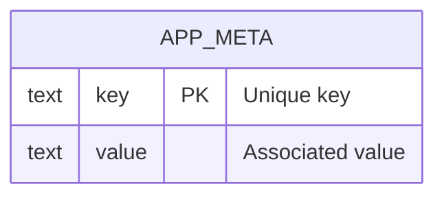

# Database schema

Current PostgreSQL schema for AbadaGlobal.

## Conventions

- Every table and column carries a `COMMENT` written next to its DDL in
  [`migrations/`](migrations/). The database is its own data dictionary.
- Query the dictionary at any time:

  ```sql
  SELECT * FROM v_data_dictionary ORDER BY "table", "column";
  SELECT * FROM v_data_dictionary WHERE "table" = 'app_meta';
  ```

- This page (ER diagram + quick reference) is a human-readable mirror of the
  migrations — update it whenever a migration changes the schema.

## ER diagram



## Tables

### `app_meta`

Key/value store for application metadata. Placeholder table demonstrating the
migration and documentation pipeline.

| Column | Type | Nullable | Default | Comment |
| ------ | ---- | -------- | ------- | ------- |
| `key` | `text` | no | — | Unique key identifying the metadata entry. |
| `value` | `text` | no | — | Value associated with the key. |

## Views

### `v_data_dictionary`

Queryable data dictionary: every user table/view with its columns, types, and
comments. Created by [`migrations/002_data_dictionary.sql`](migrations/002_data_dictionary.sql).

> Full generated reference: `SELECT * FROM v_data_dictionary ORDER BY "table", "column";`