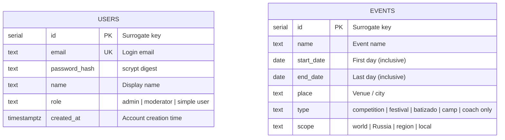

# Database schema

Current PostgreSQL schema for AbadaGlobal.

## Conventions

- Every table and column carries a `COMMENT` written next to its DDL in
  [`migrations/`](migrations/). The database is its own data dictionary.
- Query the dictionary at any time:

  ```sql
  SELECT * FROM v_data_dictionary ORDER BY "table", "column";
  SELECT * FROM v_data_dictionary WHERE "table" = 'events';
  ```

- This page (ER diagram + quick reference) is a human-readable mirror of the
  migrations — update it whenever a migration changes the schema.

## ER diagram



## Tables

### `users`

MVP accounts (login with email + password). All roles have equal rights in
the MVP — only the logged-in state matters.

| Column | Type | Nullable | Default | Comment |
| ------ | ---- | -------- | ------- | ------- |
| `id` | `integer` | no | `nextval(...)` | Surrogate primary key. |
| `email` | `text` | no | — | Unique login email. |
| `password_hash` | `text` | no | — | scrypt digest of the password (salt `abadaglobal-mvp-salt`), 64-byte hex. |
| `name` | `text` | no | — | Display name of the user. |
| `role` | `text` | no | — | `admin`, `moderator`, or `simple user` (CHECK constraint). |
| `created_at` | `timestamptz` | no | `now()` | Account creation time. |

### `events`

Calendar events for the MVP. Data comes from the hardcoded 2026–2027 seed
list; create/edit (CRUD) is deferred post-MVP.

| Column | Type | Nullable | Default | Comment |
| ------ | ---- | -------- | ------- | ------- |
| `id` | `integer` | no | `nextval(...)` | Surrogate primary key. |
| `name` | `text` | no | — | Event name shown on the calendar panel. |
| `start_date` | `date` | no | — | First day of the event (inclusive). |
| `end_date` | `date` | no | — | Last day of the event (inclusive). |
| `place` | `text` | no | — | Standardized English place name; `TBD` where the source gives no venue. |
| `type` | `text` | no | — | `competition`, `festival`, `batizado`, `camp`, `coach only` (CHECK constraint). |
| `scope` | `text` | no | — | `world`, `Russia`, `region`, `local` (CHECK constraint). Drives the calendar panel color. |

Unique constraints:

- `users.email` — one account per email (also makes the seed idempotent).
- `events (name, start_date)` — the same event name + start date may exist only once.

## Seed data

Applied by [`migrations/004_seed_mvp.sql`](migrations/004_seed_mvp.sql):

- Users: `admin@gmail.com` / `1234` (Admin, admin), `user@gmail.com` / `4321`
  (User, simple user). Passwords are precomputed scrypt digests; the app
  compares logins with the same salt and parameters.
- Events: the 17 normalized 2026–2027 events
  ([wiki source](../../Design/wiki/sources/hardcoded-events.md)). Unresolved
  source values are resolved for the seed and noted in SQL comments
  (Festival Cultural → `region`, kids camp venue → Moscow Region,
  Jogos Mundiais → month-wide August 2027, place `TBD`).

Re-running `npm run db:migrate` is safe: both inserts use `ON CONFLICT DO
NOTHING`.

## Views

### `v_data_dictionary`

Queryable data dictionary: every user table/view with its columns, types, and
comments. Created by [`migrations/002_data_dictionary.sql`](migrations/002_data_dictionary.sql).

> Full generated reference: `SELECT * FROM v_data_dictionary ORDER BY "table", "column";`