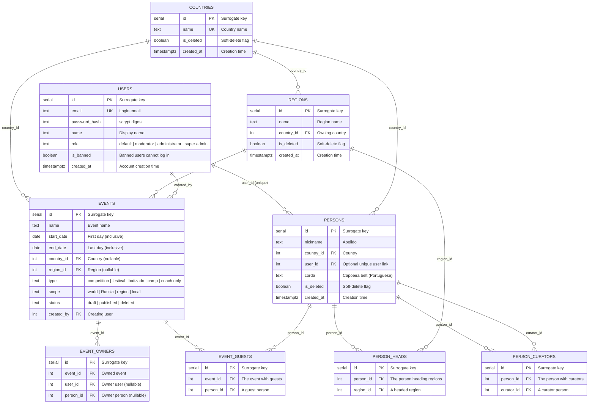

# Database schema

Current PostgreSQL schema for AbadaGlobal.

## Conventions

- Every table and column carries a `COMMENT` written next to its DDL in
  [`migrations/`](migrations/). The database is its own data dictionary.
- Query the dictionary at any time:

  ```sql
  SELECT * FROM v_data_dictionary ORDER BY "table", "column";
  SELECT * FROM v_data_dictionary WHERE "table" = 'events';
  ```

- This page (ER diagram + quick reference) is a human-readable mirror of the
  migrations — update it whenever a migration changes the schema.

## ER diagram



## Tables

### `users`

Accounts (login with email + password). Four rights levels; super admin cannot
be stripped of rights and at least one must always exist (startup check).

| Column | Type | Nullable | Default | Comment |
| ------ | ---- | -------- | ------- | ------- |
| `id` | `integer` | no | `nextval(...)` | Surrogate primary key. |
| `email` | `text` | no | — | Unique login email. |
| `password_hash` | `text` | no | — | scrypt digest of the password (salt `abadaglobal-mvp-salt`), 64-byte hex. |
| `name` | `text` | no | — | Display name of the user. |
| `role` | `text` | no | — | `default`, `moderator`, `administrator`, or `super admin` (CHECK constraint). |
| `is_banned` | `boolean` | no | `false` | Banned users cannot log in. |
| `created_at` | `timestamptz` | no | `now()` | Account creation time. |

### `countries`

Countries managed on the moderation page; referenced by regions, persons, and
events.

| Column | Type | Nullable | Default | Comment |
| ------ | ---- | -------- | ------- | ------- |
| `id` | `integer` | no | `nextval(...)` | Surrogate primary key. |
| `name` | `text` | no | — | Country name (unique). |
| `is_deleted` | `boolean` | no | `false` | Soft-delete flag (mark as deleted). |
| `created_at` | `timestamptz` | no | `now()` | Creation time. |

### `regions`

Regions within a country, managed on the moderation page; referenced by events.

| Column | Type | Nullable | Default | Comment |
| ------ | ---- | -------- | ------- | ------- |
| `id` | `integer` | no | `nextval(...)` | Surrogate primary key. |
| `name` | `text` | no | — | Region name (unique within a country). |
| `country_id` | `integer` | no | — | Owning country (FK → `countries.id`). |
| `is_deleted` | `boolean` | no | `false` | Soft-delete flag (mark as deleted). |
| `created_at` | `timestamptz` | no | `now()` | Creation time. |

### `persons`

Real people in the school, identified by country + nickname (apelido). A
person may be linked to at most one user; a person can exist without a user
and vice versa. Since version 0.3 a person may carry a capoeira belt
(`corda`); the title is derived from it and never stored. Curators and headed
regions live in `person_curators` / `person_heads`.

| Column | Type | Nullable | Default | Comment |
| ------ | ---- | -------- | ------- | ------- |
| `id` | `integer` | no | `nextval(...)` | Surrogate primary key. |
| `nickname` | `text` | no | — | Nickname (apelido) of the person. |
| `country_id` | `integer` | no | — | Country of the person (FK → `countries.id`). |
| `user_id` | `integer` | yes | — | Optional link to the user account (FK → `users.id`, unique). |
| `corda` | `text` | yes | — | Capoeira belt (Portuguese, CHECK constraint). Title is derived, never stored. |
| `is_deleted` | `boolean` | no | `false` | Soft-delete flag (mark as deleted). |
| `created_at` | `timestamptz` | no | `now()` | Creation time. |

### `events`

Calendar events. `place` (text) was replaced by `country_id` + `region_id`;
events carry a lifecycle status and a creator, and can have an owner list.

| Column | Type | Nullable | Default | Comment |
| ------ | ---- | -------- | ------- | ------- |
| `id` | `integer` | no | `nextval(...)` | Surrogate primary key. |
| `name` | `text` | no | — | Event name shown on the calendar panel. |
| `start_date` | `date` | no | — | First day of the event (inclusive). |
| `end_date` | `date` | no | — | Last day of the event (inclusive). |
| `country_id` | `integer` | yes | — | Country of the event (FK → `countries.id`; nullable while TBD). |
| `region_id` | `integer` | yes | — | Region of the event (FK → `regions.id`; nullable). |
| `type` | `text` | no | — | `competition`, `festival`, `batizado`, `camp`, `coach only` (CHECK constraint). |
| `scope` | `text` | no | — | `world`, `Russia`, `region`, `local` (CHECK constraint). Drives the calendar panel color. |
| `status` | `text` | no | `published` | `draft`, `published`, or `deleted` (CHECK constraint; deleted = soft delete). |
| `created_by` | `integer` | no | — | Creating user (FK → `users.id`). |

### `person_curators`

Curator list of a person (version 0.3). A person has no curators by default
(NULL in the API when the list is empty).

| Column | Type | Nullable | Default | Comment |
| ------ | ---- | -------- | ------- | ------- |
| `id` | `integer` | no | `nextval(...)` | Surrogate primary key. |
| `person_id` | `integer` | no | — | The person who has curators (FK → `persons.id`, cascade delete). |
| `curator_id` | `integer` | no | — | A curator person of the person (FK → `persons.id`, cascade delete). |

### `person_heads`

Regions headed by a person (version 0.3). A person heads no regions by default
(NULL in the API when the list is empty).

| Column | Type | Nullable | Default | Comment |
| ------ | ---- | -------- | ------- | ------- |
| `id` | `integer` | no | `nextval(...)` | Surrogate primary key. |
| `person_id` | `integer` | no | — | The person who heads a region (FK → `persons.id`, cascade delete). |
| `region_id` | `integer` | no | — | A region headed by the person (FK → `regions.id`, cascade delete). |

### `event_guests`

Guest list of an event (version 0.3), shown at the top of the event
information in the event pop-up and on the event page.

| Column | Type | Nullable | Default | Comment |
| ------ | ---- | -------- | ------- | ------- |
| `id` | `integer` | no | `nextval(...)` | Surrogate primary key. |
| `event_id` | `integer` | no | — | The event with guests (FK → `events.id`, cascade delete). |
| `person_id` | `integer` | no | — | A guest person of the event (FK → `persons.id`, cascade delete). |

### `event_owners`

Owner list of an event: users and/or persons. The creator is added
automatically and may remove themselves; owners can be added and removed.

| Column | Type | Nullable | Default | Comment |
| ------ | ---- | -------- | ------- | ------- |
| `id` | `integer` | no | `nextval(...)` | Surrogate primary key. |
| `event_id` | `integer` | no | — | The owned event (FK → `events.id`, cascade delete). |
| `user_id` | `integer` | yes | — | Owner user (FK → `users.id`; exactly one of user/person is set). |
| `person_id` | `integer` | yes | — | Owner person (FK → `persons.id`; exactly one of user/person is set). |

Unique constraints:

- `users.email` — one account per email (also makes the seed idempotent).
- `events (name, start_date)` — the same event name + start date may exist only once.
- `countries.name` — one country per name.
- `regions (country_id, name)` — one region per name within a country.
- `persons (country_id, nickname)` — one person per nickname within a country.
- `persons.user_id` — a user may be linked to at most one person.
- `event_owners` — partial unique indexes on `(event_id, user_id)` and
  `(event_id, person_id)` prevent duplicate owners.
- `person_curators (person_id, curator_id)` — one curator per person.
- `person_heads (person_id, region_id)` — one region per person.
- `event_guests (event_id, person_id)` — one guest entry per person.

## Seed data

Applied by [`migrations/004_seed_mvp.sql`](migrations/004_seed_mvp.sql) and
[`migrations/006_seed_version02.sql`](migrations/006_seed_version02.sql):

- Users: `superadmin@gmail.com` / `1234` (Super Admin, super admin),
  `admin@gmail.com` / `1234` (Admin, administrator), `user@gmail.com` / `4321`
  (User, default). Passwords are precomputed scrypt digests; the app compares
  logins with the same salt and parameters.
- Countries: Russia, Luxembourg, Brazil.
- Regions: Samara, Moscow Region, Saint Petersburg, Voronezh, Yekaterinburg,
  Moscow (Russia); Rio de Janeiro (Brazil).
- Events: the 17 normalized 2026–2027 events re-pointed to country/region
  (Jogos Mundiais keeps NULL country/region — venue TBD), all `published`,
  `created_by` = super admin, super admin added as owner of each.
- Persons: none seeded (created via the moderation page).

Re-running `npm run db:migrate` is safe: all inserts use `ON CONFLICT DO
NOTHING` and the role/event updates are guarded.

## Views

### `v_data_dictionary`

Queryable data dictionary: every user table/view with its columns, types, and
comments. Created by [`migrations/002_data_dictionary.sql`](migrations/002_data_dictionary.sql).

> Full generated reference: `SELECT * FROM v_data_dictionary ORDER BY "table", "column";`