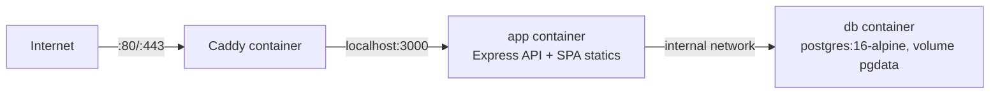

# AbadaGlobal — Yandex Cloud deployment

Everything needed to deploy and update the site on the Yandex Cloud VM.

## Connection info (Yandex Cloud)

| Item | Value |
|---|---|
| VM name | `webapp-vm` (ru-central1-a, Standard v3, 2 vCPU / 4 GB, 20 GB SSD) |
| Public IP | `93.77.164.111` |
| SSH user | `abada` (sudo, password auth disabled) |
| SSH command | `ssh -i C:\Users\iiyii\.ssh\id_ed25519 abada@93.77.164.111` |
| OS | Ubuntu 24.04 (kernel 6.8) |
| Security group | TCP 22 / 80 / 443 from `0.0.0.0/0` |

> Secret values (DB password, `AUTH_SECRET`) live only in [`connections.env`](connections.env) — gitignored. `SSH_KEY` private key is at `C:\Users\iiyii\.ssh\id_ed25519`.

## Architecture (adjusted: PostgreSQL runs in Docker on the VM)

Managed PostgreSQL was dropped as too expensive — the database now runs as a container on the same VM:



- One VM, one compose stack (`docker compose up`).
- `DATABASE_URL=postgres://appuser:<pass>@db:5432/appdb` — **no `?ssl=true`**: containers talk over the internal docker network, where PostgreSQL has no TLS. (`?ssl=true` from the Yandex assistant's checklist would break the connection.)
- Port `5432` is not exposed outside the VM — the DB is unreachable from the internet.
- The app serves the built SPA from `Frontend/dist` (Topology A), so there is no separate static host.

## Files

| File | Purpose |
|---|---|
| [`connections.env`](connections.env) | **Private.** VM + DB + auth secrets (gitignored) |
| [`docker-compose.yml`](docker-compose.yml) | Stack: `db` + `app` + `caddy` |
| [`Dockerfile`](Dockerfile) | Multi-stage: builds Frontend + Backend, runs `node dist/src/server.js` |
| [`Caddyfile`](Caddyfile) | Reverse proxy `:80` → `app:3000` (TLS-ready when a domain is added) |
| [`deploy.sh`](deploy.sh) | Local orchestrator: bundle → upload → provision → migrate → up |
| [`remote/setup.sh`](remote/setup.sh) | Runs on the VM: Docker install, image build, migrations, start |

## Deploy / update

From this workspace (bash — Git Bash/WSL):

```bash
cd Deploy && bash deploy.sh
```

Manual equivalent (what the assistant runs):

1. Bundle: `tar -czf src.tar.gz --exclude=node_modules --exclude=dist --exclude=.git -C .. Backend Frontend`
2. Upload: `scp src.tar.gz docker-compose.yml Dockerfile Caddyfile remote/setup.sh abada@93.77.164.111:/srv/abadaglobal/`
3. Env: derive `.env` from `connections.env` (done inside `deploy.sh`)
4. Remote: `ssh abada@… "cd /srv/abadaglobal && bash setup.sh"`
5. Verify: `curl http://93.77.164.111/api/health`

## Operations

```bash
ssh abada@93.77.164.111
cd /srv/abadaglobal
docker compose ps                 # status
docker compose logs -f app        # app logs
docker compose logs -f db         # database logs
docker compose run --rm app node dist/db/migrate.js   # re-run migrations (idempotent)
docker compose up -d --build      # rebuild after code change (after uploading new src)
docker compose down               # stop everything (data preserved in pgdata)
```

## Security notes

- SSH is key-only; private key stays on this machine (`C:\Users\iiyii\.ssh\id_ed25519`).
- `/srv/abadaglobal/.env` on the VM holds `DB_PASSWORD` and `AUTH_SECRET`; rotate with:
  `node -e "console.log(require('crypto').randomBytes(32).toString('hex'))"`
- `connections.env` and `Deploy/.env` must never be committed. A `Deploy/.gitignore` covering them is pending manual creation (the assistant's ignore rules block `.gitignore` files).

## Roadmap

- [x] VM provisioned, SSH key auth verified
- [ ] Dockerized stack live (db → migrations → app → Caddy)
- [ ] Custom domain + HTTPS (Caddy auto-TLS) — needs a domain and the `webapp-vm` IP
- [ ] Backups: `pg_dump` cron on the VM