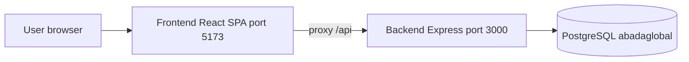
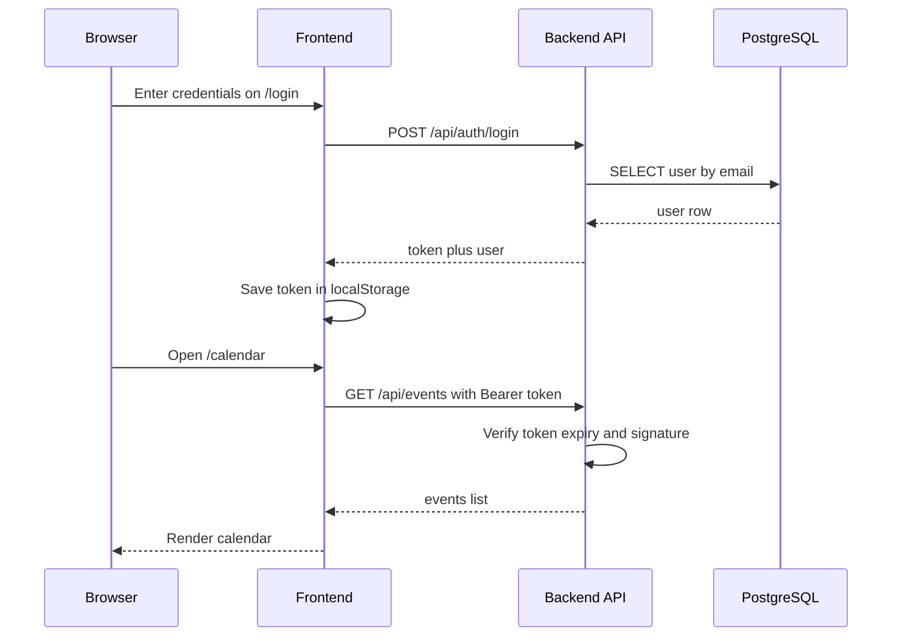
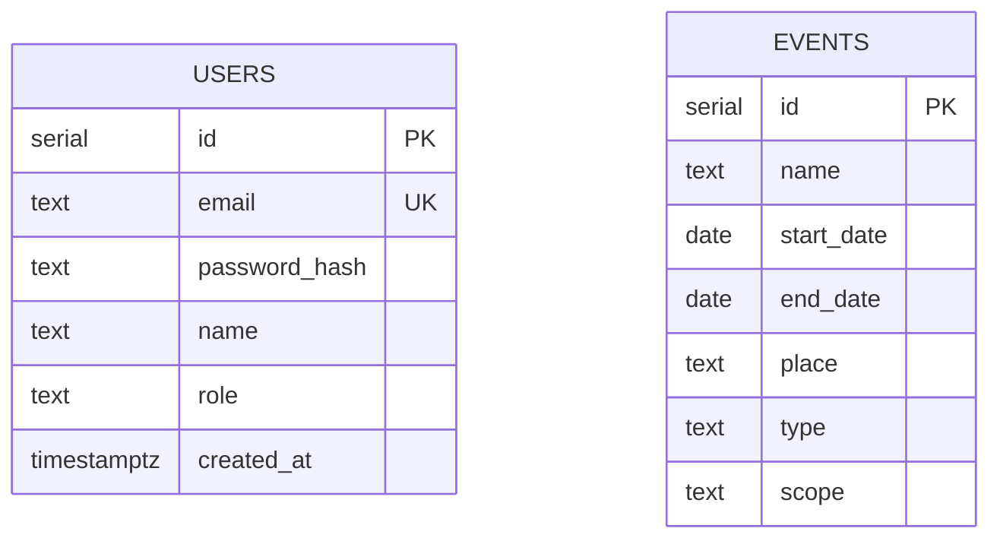

# AbadaGlobal MVP — Plan

Status: draft for review.
Date: 2026-10-07
Source of scope: [`MVPscope`](../../MVPscope)

## 1. Goal

Build and run the MVP on the local machine: a React SPA backed by an Express
API that reads hardcoded users and events from a local PostgreSQL database.
Both backend and frontend are hosted locally (no deployment).

## 2. Scope

In scope (per `MVPscope` + event page):

1. Login page — email + password against two hardcoded users
2. Calendar page — events from a hardcoded set; month/week/day views;
   filters by scope and type; event panels with scope colors; popup with a
   link to the event page
3. Event page — full event information
4. Navigation panel — left sidebar on desktop, burger menu on mobile;
   buttons: main, calendar, database, profile, settings, log out
5. Under construction page — fixed copy for not-yet-implemented pages
6. Restricted page — shown to unlogged users trying to open protected pages
7. Language switcher — Russian (default), English, Portuguese

Out of scope (post-MVP): event create/edit (CRUD), notifications, video
database, role-based permission differences, real main-page content.

## 3. Architecture



Auth flow:



### Route map (frontend)

| Path | Auth | Behavior |
| ---- | ---- | -------- |
| `/login` | public | Login form; redirects to `/calendar` if already logged in |
| `/` | public | Redirects to `/login` when logged out, to `/calendar` when logged in |
| `/calendar` | required | Calendar page; unlogged users see the restricted page |
| `/events/:id` | required | Event page |
| `/database`, `/profile`, `/settings` | required | Under construction page |
| nav "Main" | required | Points to `/` which lands on the calendar in the MVP |

### API surface (backend, mounted at `/api`)

| Method | Path | Auth | Purpose |
| ------ | ---- | ---- | ------- |
| GET | `/health` | no | Liveness check (exists) |
| POST | `/auth/login` | no | `{ email, password }` → `{ token, user }` |
| GET | `/auth/me` | bearer | Current user from token |
| GET | `/events?scope=&type=` | bearer | List events, optional filters |
| GET | `/events/:id` | bearer | Single event or 404 |

## 4. Key decisions

| # | Decision | Choice | Rationale |
| - | -------- | ------ | --------- |
| 1 | Storage | PostgreSQL via the existing migration pipeline | Users/events stored on the backend; tables and seed shipped as migrations so `npm run db:migrate` is the single setup step |
| 2 | Passwords | scrypt hashes (Node built-in crypto), precomputed constants in the seed SQL | No new dependencies; no plaintext passwords |
| 3 | Token | Opaque HMAC-signed token via Node `crypto` (no JWT dependency); 7-day expiry; `Authorization: Bearer` header; stored in `localStorage` | Stateless, zero extra packages, matches the 7-day decision in the wiki |
| 4 | Main page | Out of MVP scope; `/` and the nav "Main" button land on the calendar for logged-in users | Avoids a dead-end landing screen; main page content is post-MVP |
| 5 | i18n | Lightweight `I18nProvider` context + `ru` / `en` / `pt` dictionaries; default `ru`; switcher in the nav panel | Three languages in scope, implementation starts with Russian; no heavy i18n library needed for the MVP |
| 6 | Calendar views | Months (default), weeks, days; vertical scroll; scope filter (world, Russia, region, local); type filter (competition, festival, batizado, camp, coach only) | Per calendar spec |
| 7 | Scope colors | world=red, Russia=blue, region=green, local=yellow | Per calendar spec |
| 8 | Contract-first | Extend `Contracts/api/openapi.yaml` with auth and event paths/schemas before implementing | Wiki rule: the OpenAPI file is the single source of truth |
| 9 | Enums | `TEXT` columns with `CHECK` constraints (`type`, `scope`, `role`) | Keeps seed SQL simple; avoids rigid PG enum types |

## 5. Data model



- `users.role` ∈ admin | moderator | simple user (all equal in MVP)
- `events.type` ∈ competition | festival | batizado | camp | coach only
- `events.scope` ∈ world | Russia | region | local

### Seed data

Users (passwords stored as scrypt hashes):

| Email | Password | Name | Role |
| ----- | -------- | ---- | ---- |
| `admin@gmail.com` | `1234` | Admin | admin |
| `user@gmail.com` | `4321` | User | simple user |

Events: the normalized 2026–2027 list from
[`Design/wiki/sources/hardcoded-events.md`](../../Design/wiki/sources/hardcoded-events.md)
(17 events). Unresolved values in the source are resolved for the seed and
marked in a SQL comment: Festival Cultural scope → `region`; Capoeira na Beira
do Volga scope → `local`; kids camp place → Moscow Region; Jogos Mundiais →
`2027-08-01..2027-08-31`, place `TBD`.

## 6. Implementation phases

1. **DB**: migrations `003_mvp_domain.sql` (tables) + `004_seed_mvp.sql`
   (users + events); update `db/SCHEMA.md`
2. **Contract**: extend `Contracts/api/openapi.yaml`
3. **Backend auth**: `env` secret, models, services, controller, routes,
   `requireAuth` middleware
4. **Backend events**: service, controller, routes
5. **Backend tests**: auth + events (service-level with mocked pool)
6. **Frontend foundation**: i18n, auth context, API client/types, nav panel,
   protected routing and layout
7. **Frontend pages**: login, calendar, event, under construction, restricted
8. **Frontend tests**: login, calendar, nav, restricted/under-construction, i18n
9. **Integration**: run both servers, verify the full user journey

See [`tasks.md`](tasks.md) for the detailed checklist.

## 7. Acceptance criteria

1. `npm run db:migrate` creates `users` and `events` and seeds 2 users + 17 events
2. `GET /api/health` returns ok; `POST /api/auth/login` works for both users
   and rejects bad credentials with 401
3. Event endpoints return 401 without a valid token and 200 with one;
   `/events/:id` returns 404 for unknown ids
4. `/login` logs in, stores the token, and lands on `/calendar`
5. Calendar shows all seeded events; scope/type filters work; months/weeks/days
   views switch; panels carry scope colors; clicking a panel opens the popup
   and its link opens the event page
6. Unlogged users hitting `/calendar` or `/events/:id` see the restricted
   page with the "Please log in to continue" copy
7. Database / Profile / Settings show the under construction copy
8. Language switcher switches UI strings between ru/en/pt (default ru)
9. Log out clears the token and returns to `/login`
10. All checks pass: `npm run typecheck`, `npm test`, `npm run build` in both
    apps

## 8. Running locally

Prerequisite: a running PostgreSQL server (any of):

- Existing local install — ensure a database named `abadaglobal` exists
- Docker: `docker run --name abadaglobal-db -e POSTGRES_PASSWORD=postgres -e POSTGRES_DB=abadaglobal -p 5432:5432 -d postgres`

```bash
# Backend
cd Backend
npm install
copy .env.example .env          # adjust DATABASE_URL if needed
npm run db:migrate
npm run dev                     # http://localhost:3000

# Frontend (separate terminal)
cd Frontend
npm install
copy .env.example .env          # leave VITE_API_BASE_URL empty to use the proxy
npm run dev                     # http://localhost:5173
```

Open `http://localhost:5173` and log in with one of the seed users.

## 9. Open items / notes

- Jogos Mundiais exact dates/city and kids-camp venue remain TBD in the source;
  resolved with placeholder values for the seed (noted in SQL comments)
- If `AUTH_SECRET` is missing, the backend falls back to a development-only
  constant (env validation warns); the seed hash salt is a fixed string shared
  by app code and seed SQL