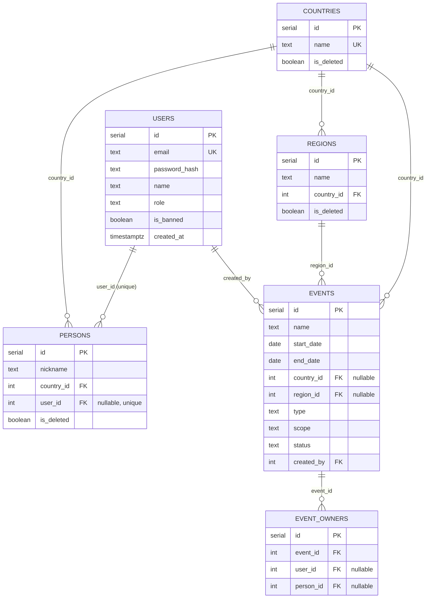

# AbadaGlobal version0.2 — Plan

Status: draft for review.
Date: 2026-10-18
Source of scope: [`Design/Increment/version0.2.md`](../../Design/Increment/version0.2.md) and the supporting increment docs (adminpage, levelofrights, moderationpage, usersandperson, calendar, navigationpanel).

## 1. Goal

Extend the working MVP into version0.2: introduce a 4-level rights model, an
admin panel, a moderation page (countries / regions / persons), event creation
and editing with a richer event entity (country+region, status, owner list),
user banning, and a super-admin guarantee. Both apps stay local.

## 2. Scope

In scope:

1. **Rights model** — four levels: `default | moderator | administrator | super admin`.
   Replaces the MVP roles `admin | moderator | simple user` (mapping: simple
   user → default, admin → administrator, moderator → moderator, plus new super admin).
2. **Admin panel** (`/administration`) — list all users; change a user's rights
   (any user except super admin); ban / unban a user. Administrators may change
   or ban each other; only super admin is protected.
3. **Moderation page** (`/moderation`, 3 tabs) — countries, regions, persons:
   add / edit / soft-delete, search by name, filter by country (regions and
   persons), and link / unlink a person to a user.
4. **Event entity rework** — `place` (text) becomes `country_id` + `region_id`
   (links to the new country / region entities); add `status`
   (`draft | published | deleted`); add `created_by` (user); add an **owner
   list** (users and persons). Creator is auto-added as an owner; owners can be
   added and removed.
5. **Create new event** — any logged-in user sees a "create new event" button on
   the calendar; a form page with event fields; actions "cancel", "publish
   event", "save as draft" (draft disabled for now).
6. **Edit event** — owner, moderator, or administrator can edit; an "edit event"
   button appears on the event popup and the event page.
7. **Event soft-delete** — `status = deleted`; allowed for owner / moderator /
   administrator.
8. **Ban** — a banned user cannot log in; the login page shows
   "you are banned, contact administrator".
9. **Super admin guarantee** — at least one super admin must exist; if none is
   found at startup, the backend logs a fatal error and exits.
10. **Navigation** — two new buttons "moderation" and "administration", shown
    only to users with the corresponding rights.
11. **i18n** — all new UI translated in ru / en / pt.

Out of scope (later versions): private-data visibility (all data public for
now), extra person fields, notifications, video database, full draft workflow
(the draft button exists but is disabled).

## 3. Architecture

Same monorepo as the MVP. New backend modules for countries / regions /
persons / admin; new frontend pages for moderation, administration, and the
event create/edit form. Auth stays token-based; a new `requireRole` middleware
guards moderation and administration routes.

## 4. Key decisions

| # | Decision | Choice | Rationale |
| - | -------- | ------ | --------- |
| 1 | Role vocabulary | `default \| moderator \| administrator \| super admin` in the DB | Matches the new rights doc; migrate existing seed users |
| 2 | Event location | `country_id` + `region_id` (both nullable) replace `place` text | Place is now a complex entity; region optional (Luxembourg, TBD) |
| 3 | Event status | `draft \| published \| deleted`; calendar shows published; draft visible to owner/moderator/administrator | Supports create/edit and soft-delete |
| 4 | Event ownership | `event_owners` join table (event ↔ user **or** person); creator auto-added; owners addable/removable | "Owner is a list of users and persons" |
| 5 | Person | `nickname + country` only for now; optional unique link to a user | Per usersandperson doc; more fields later |
| 6 | Soft delete | `is_deleted` on countries/regions/persons; `status=deleted` on events | Moderation "mark as deleted" |
| 7 | Ban | `users.is_banned`; login rejects banned users with a specific message | Per adminpage + user decision |
| 8 | Super admin | startup check: query for a super admin; fatal + exit if none | Per levelofrights doc |
| 9 | Access | moderation: moderator+; administration: administrator+ | Per levelofrights doc |
| 10 | Contract-first | extend `Contracts/api/openapi.yaml` before implementing | Wiki rule: OpenAPI is the source of truth |

## 5. Data model

- `users.role` ∈ default | moderator | administrator | super admin
- `users.is_banned` boolean, default false
- `events.status` ∈ draft | published | deleted
- `events.type` ∈ competition | festival | batizado | camp | coach only
- `events.scope` ∈ world | Russia | region | local
- `event_owners` has a CHECK that exactly one of `user_id` / `person_id` is set,
  plus partial unique indexes to prevent duplicate owners.

### Seed data

- Users: `superadmin@gmail.com` / `1234` (super admin), `admin@gmail.com` / `1234`
  (administrator), `user@gmail.com` / `4321` (default). Existing roles migrated.
- Countries: Russia, Luxembourg, Brazil.
- Regions: Samara, Moscow Region, Saint Petersburg, Voronezh, Yekaterinburg,
  Moscow (Russia); Rio de Janeiro (Brazil).
- Events: the 17 MVP events re-pointed to country/region; Jogos Mundiais keeps
  null country/region (TBD); all seeded as `published`; `created_by` = super admin;
  super admin added as owner of each.
- Persons: none seeded (created via the moderation page).

## 6. Implementation phases

1. **DB**: migrations `005_version02_domain.sql` (schema changes + new tables) and
   `006_seed_version02.sql` (roles, super admin, countries/regions, event re-point);
   update `Backend/db/SCHEMA.md`.
2. **Contract**: extend `Contracts/api/openapi.yaml` (roles, countries, regions,
   persons, admin, event create/edit/delete, ban).
3. **Backend auth**: role-aware user model, banned-login rejection, `requireRole`
   middleware, super-admin startup check.
4. **Backend events**: create / update / soft-delete with permission checks and
   owner management; list filters by status.
5. **Backend moderation**: countries, regions, persons services/controllers/routes.
6. **Backend admin**: list users, change role, ban/unban.
7. **Backend tests**: auth (banned), events (CRUD + permissions), moderation CRUD,
   admin, super-admin check.
8. **Frontend foundation**: updated types/client, role helpers in auth context,
   nav buttons by rights.
9. **Frontend pages**: event create/edit form, moderation page (3 tabs), admin page;
   update calendar (create button, edit on popup) and event page (edit button,
   country/region/status).
10. **Frontend tests**: new pages, role-gated nav, create/edit form, moderation,
    admin.
11. **Integration**: run both servers, verify the full journey.

See [`tasks.md`](tasks.md) for the detailed checklist.

## 7. Acceptance criteria

1. `npm run db:migrate` applies the new schema and seed; roles migrated; super
   admin exists; countries/regions seeded; 17 events re-pointed to country/region.
2. Backend fails to start (fatal + exit) if no super admin exists.
3. Banned user login returns the "you are banned" error; valid users log in.
4. Any logged-in user can create an event (published); creator becomes owner.
5. Owner / moderator / administrator can edit and soft-delete an event; others
   cannot.
6. Calendar shows published events; a "create new event" button is present; the
   event popup and event page show "edit event" for authorized users.
7. Moderation page (3 tabs) lists and manages countries, regions, persons with
   search/filter and soft-delete; persons can be linked/unlinked to users.
8. Admin page lists users; rights can be changed (except super admin); users can
   be banned/unbanned.
9. Navigation shows moderation / administration buttons only to users with rights.
10. All new UI is translated ru/en/pt.
11. `npm run typecheck`, `npm test`, `npm run build` pass in both apps.

## 8. Running locally

Same as the MVP (PostgreSQL up, `npm run db:migrate`, backend `npm run dev` on
3000, frontend `npm run dev` on 5173). Logins:
`superadmin@gmail.com` / `1234`, `admin@gmail.com` / `1234`, `user@gmail.com` / `4321`.

## 9. Open items / notes

- Jogos Mundiais country/region remain TBD (null) until corrected from the admin
  window.
- Person entity intentionally minimal (nickname + country) for this version.
- All data is public for now; private-data visibility is deferred.