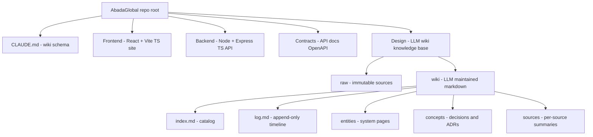

# AbadaGlobal

Monorepo for the AbadaGlobal site project.

## Repository layout

| Folder | Purpose |
| ------ | ------- |
| [`Frontend/`](Frontend/README.md) | Site part — React + Vite + TypeScript single-page application |
| [`Backend/`](Backend/README.md) | API server + database layer — Node.js + Express + TypeScript, PostgreSQL |
| [`Contracts/`](Contracts/README.md) | API contract documentation — OpenAPI specs, endpoint conventions |
| [`Design/`](Design/README.md) | Project knowledge base — LLM-maintained wiki (Karpathy LLM-wiki pattern): raw sources, wiki pages, index and log |

## Architecture overview

The frontend talks to the backend over HTTP. The backend persists to PostgreSQL.
The API surface is defined once in [`Contracts/api/openapi.yaml`](Contracts/api/openapi.yaml)
and is the single source of truth for both sides.

Project knowledge — requirements, decisions, research, meeting notes — is
maintained as an LLM wiki under [`Design/wiki/`](Design/wiki/). See
[`CLAUDE.md`](CLAUDE.md) for the schema and workflows agents must follow.

## Getting started

See the per-package READMEs:

- [`Frontend/README.md`](Frontend/README.md) — running the site
- [`Backend/README.md`](Backend/README.md) — running the API and database
- [`Design/README.md`](Design/README.md) — working with the wiki